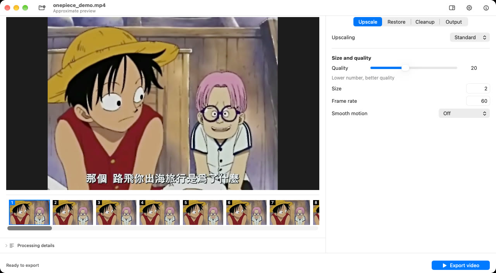
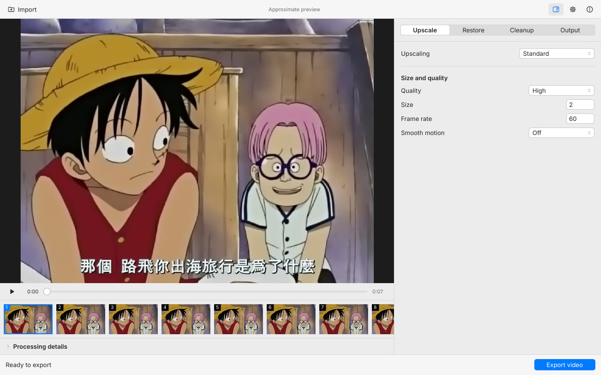

# myUpscaler

Upscale and restore video on Mac and Windows.

<table>
<tr>
<td width="50%"></td>
<td width="50%"></td>
</tr>
<tr>
<td align="center">Mac</td>
<td align="center">Windows</td>
</tr>
</table>

[Demo video](https://github.com/marshiyar/myUpscaler/releases/download/v0.1.0/myupscaler-demo.mp4)

- Upscale: Raise the resolution of old or small videos. AI upscaling on Mac.
- Restore: Remove noise, sharpen and correct color.
- Batch: Export a whole folder with the same settings.

## Download

[Downloads](https://github.com/marshiyar/myUpscaler/releases)

- Mac: macOS 15.7 or later, M1 or newer
- Windows: Windows 11, 64-bit

Free. No account, no upload.

## Building

```sh
git clone https://github.com/marshiyar/myUpscaler.git
cd myUpscaler
bash scripts/check-environment.sh
bash scripts/prepare-media-engine.sh
bash scripts/prepare-bundled-models.sh
open myUpscaler.xcodeproj
```

The preparation scripts download and verify the required assets. In Xcode, select the myUpscaler scheme and run it on My Mac; the build compiles the Rust backend first.

The desktop app for Windows, Linux and macOS is built with Cargo:

```sh
bash scripts/prepare-media-engine.sh
cd desktop
cargo run --release
```

See [desktop/README.md](desktop/README.md) for platform requirements and status. For development checks and additional setup options, see [CONTRIBUTING.md](CONTRIBUTING.md).

## Technical details

The macOS app needs Apple Silicon and macOS 15.7 or later. Building from source uses Xcode 27 with its Metal compiler component installed, and Rust (the toolchain is pinned in `rust-toolchain.toml`).

### Use

1. Import a video or folder, or drop a video into the window.
2. Open Adjustments and choose Standard (Lanczos) or an included AI (Real-ESRGAN) model in the Upscaling picker. Set the output scale.
3. Adjust filters on the Restore and Cleanup pages. On the Output page, choose encoding, presets and the output folder.
4. Export. Cancel stops processing.

Lanczos supports video and still images; Core ML supports video. Available controls depend on the selected engine. The frame preview approximates restoration and may differ from the export.

Shortcuts: ⌘O imports, ⌘R exports and ⌘. cancels. Bindings can be changed in Settings.

### Engine

Lanczos processing runs in a Rust backend written for this app (`backend/`): BM3D, non-local means, hqdn3d and adaptive temporal denoising; deblocking and deringing; duplicate-frame decimation; motion-compensated, blended or repeated frame interpolation; Lanczos-3 scaling; CAS and unsharp sharpening; deband, f3kdb-style and gradfun debanding; color EQ and grain. Filters run multi-threaded in float precision with a dithered 8-bit output. Decoding, H.264 encoding and MP4 muxing go through the MpVFX media engine, also written in Rust. Videos are written as 8-bit H.264 (4:2:0) MP4 with FLAC audio (HEVC and 10-bit requests are written as H.264). Stills are written as PNG with transparency kept. There is no FFmpeg and no helper process.

### Desktop app (Windows, Linux, macOS)

`desktop/` is a [Slint](https://slint.dev) interface on the same Rust backend (`backend/`), with the same settings, saved presets and a player with sound. It runs on Windows x86_64, Linux x86_64 and macOS arm64. The AI (Real-ESRGAN) scaler is only in the macOS app today; the desktop app uses the Lanczos path.

## Licenses

Application code: [Apache-2.0](LICENSE).

Core ML model assets are provided by Marshiyar. [Real-ESRGAN](https://github.com/xinntao/Real-ESRGAN) weights retain their upstream [BSD 3-Clause license](myUpscaler/ThirdParty/RealESRGAN-LICENSE.txt).

The MpVFX media engine (`libmpvfx_ffi.dylib`, from the [mpvfx-media-binaries](https://github.com/marshiyar/mpvfx-media-binaries) releases) is proprietary and is included with the app by permission of its author; its [licence](myUpscaler/ThirdParty/MpVFX-Media-LICENSE.txt) and [third-party notices](myUpscaler/ThirdParty/MpVFX-Media-NOTICE.txt) are included as app resources. It is not covered by this repository's licence.

Demo footage: [Big Buck Bunny](https://peach.blender.org/), (c) copyright 2008, Blender Foundation / www.bigbuckbunny.org, [CC BY 3.0](https://creativecommons.org/licenses/by/3.0/). Shortened, resized, compressed and upscaled.
